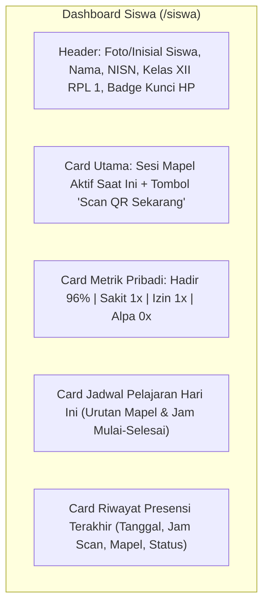
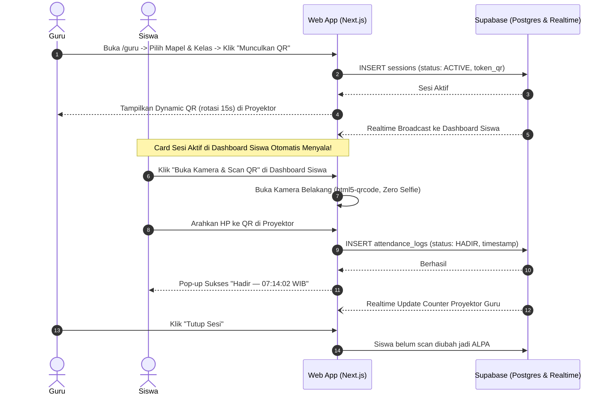
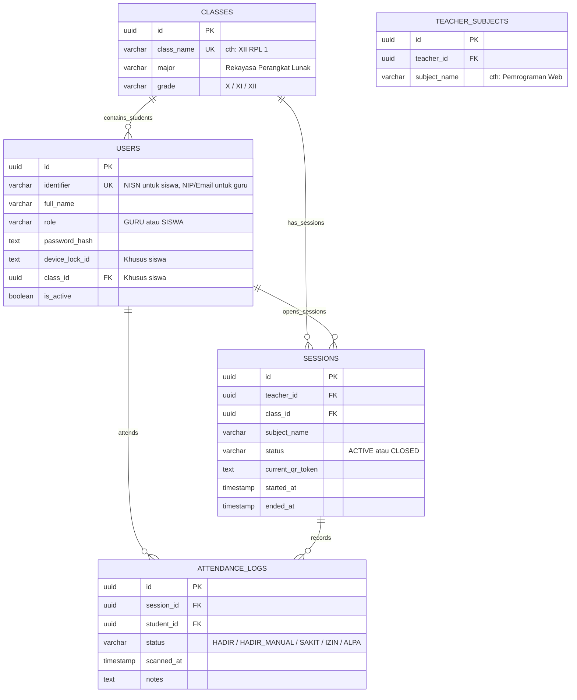

# Product Requirement Document (PRD) – Revisi Final
## Sistem Web Absensi SMK Negeri 1 Wangkelang

---

## 1. Masalah & Tujuan Produk

### 1.1 Masalah Utama
1. **Pencatatan Kertas Menyita Waktu:** Guru menghabiskan 10–15 menit di awal jam pelajaran hanya untuk memanggil presensi siswa satu per satu di kelas.
2. **Rekapitulasi Manual Lambat:** Pengumpulan data kehadiran bulanan menyita waktu karena guru harus merekap lembaran buku absen fisik secara manual.
3. **Rawan Titip Absen & Manipulasi:** Absensi manual rentan terhadap praktik titip tanda tangan antar-siswa.

### 1.2 Tujuan & Ukuran Sukses (KPI)
- **2 Role dengan Dashboard Khusus (Guru & Siswa):** Baik guru maupun siswa memiliki dashboard mandiri dengan tampilan bento-grid yang disesuaikan dengan kebutuhan perannya.
- **Efisiensi Waktu Kelas:** Proses absensi tuntas dalam $\le 2$ menit per jam pelajaran.
- **Otomatisasi & Realtime:** Status kehadiran siswa ter-update seketika di layar guru/proyektor via Supabase Realtime saat siswa scan QR.
- **Integritas Data:** Bebas titip absen berkat kombinasi *Dynamic QR Code* (rotasi 15 detik) dan *Device Lock* (1 HP 1 akun).

---

## 2. Pengguna & Hak Akses (2 Role Model)

| Role | Tanggung Jawab Utama | Hak Akses Sistem |
| :--- | :--- | :--- |
| **Guru** *(Pengelola & Pengampu)* | Pemilik penuh atas operasional kelas, mata pelajaran, data murid, dan pelaksanaan presensi. | 1. Registrasi akun guru mandiri via NIP/Email + **Kode Rahasia Sekolah** (cth: `WANGKELANG2026`). 2. **Dashboard Guru:** Bento monitoring sesi kelas, metrik kelas harian, dan grafik tren kehadiran. 3. **CRUD Kelas:** Tambah, edit, dan hapus kelas & jurusan. 4. **CRUD Murid:** Menu khusus **"Tambah Murid"** (manual form) + fitur **Upload Excel (.xlsx)** per kelas + Reset Kunci HP/Device Lock. 5. **CRUD Mapel & Jam:** Tambah/edit mata pelajaran yang diampu guru. 6. **Alur Presensi:** Pilih Mapel $\rightarrow$ Pilih Kelas $\rightarrow$ Klik **"Munculkan QR Code"**. 7. **Monitoring Realtime:** Pantau siswa masuk seketika di proyektor kelas. 8. **Override Manual:** Ubah status siswa darurat (Hadir Manual jika HP mati/rusak, Sakit, Izin). 9. **Tutup Sesi:** Mengunci sesi dan otomatis menandai siswa yang belum hadir menjadi **ALPA**. 10. **Ekspor Laporan:** Unduh rekapitulasi kehadiran ke file Excel (`.xlsx`). |
| **Siswa** | Peserta absensi mandiri dan pemantau riwayat kehadiran pribadi. | 1. Login via NISN + Password (akun dibuatkan guru). 2. Kunci 1 Akun 1 HP (*Device Lock* otomatis di login pertama). 3. **Dashboard Siswa:** Tampilan bento khusus siswa yang memuat Sesi Mapel Aktif, Metrik Kehadiran Pribadi, Jadwal Hari Ini, dan Riwayat Presensi. 4. **Action Scan QR:** Tombol cepat membuka kamera web browser HP untuk memindai Dynamic QR di proyektor kelas (**murni scan QR, tanpa selfie**). 5. Menerima notifikasi konfirmasi hadir seketika beserta jam detik kehadiran. |

---

## 3. Spesifikasi Fitur: Dashboard Guru vs Dashboard Siswa

### 3.1 Dashboard Guru (`/guru`)
1. **Header & Top Bar:** Greeting nama guru, NIP, status mengajar aktif, dan shortcut menu.
2. **Kartu Kontrol Sesi Presensi:**
   - Dropdown 1: **Pilih Mata Pelajaran** (yang diampu guru).
   - Dropdown 2: **Pilih Kelas** (dari daftar kelas sekolah).
   - Tombol Aksi: **`[ Munculkan QR Code ]`** (Membuka sesi dan menampilkan Dynamic QR rotasi 15 detik di layar/proyektor).
3. **Live Attendance Counter:** Real-time kehadiran (`X / Y Siswa Hadir`) via Supabase Realtime WebSocket.
4. **Matriks Metrik Kelas (2x2):** Total Hadir, Sakit, Izin, Alpa pada sesi aktif.
5. **Grafik Tren Mingguan:** Bar chart kehadiran hari Senin s/d Jumat dengan highlight batang aktif hijau lime `#8CE827`.
6. **Tombol Quick Actions:** `Hadir Manual` (bantu siswa tanpa HP), `Tutup Sesi` (auto-Alpa sisa siswa), dan `Ekspor Excel`.

### 3.2 Dashboard Siswa (`/siswa`)
Dashboard khusus siswa yang mengusung desain bento modern (responsif HP & desktop):

1. **Header Profil Siswa:**
   - Nama Lengkap Siswa, NISN, Kelas (misal: *XII RPL 1*), dan indikator badge *"Perangkat Terkunci (HP Ini)"*.
2. **Card Utama: Status Sesi Mapel Aktif (Live Banner):**
   - Mendeteksi secara real-time apakah ada guru yang sedang membuka sesi absensi untuk kelasnya.
   - **Jika Ada Sesi Terbuka:** Tampil box hijau lime aktif berisi nama mapel, nama guru pengampu, sisa waktu sesi, dan tombol besar **`[ Buka Kamera & Scan QR ]`**.
   - **Jika Tidak Ada Sesi:** Tampil pesan tenang *"Belum ada sesi absensi aktif untuk kelasmu saat ini"*.
3. **Metrik Kehadiran Pribadi (Bento 2x2):**
   - **Total Hadir:** Jumlah pertemuan hadir + persentase kerajinan (cth: `96.2%`).
   - **Sakit:** Jumlah izin sakit tercatat.
   - **Izin:** Jumlah izin keperluan keluarga.
   - **Alpa:** Jumlah tanpa keterangan (harus 0).
4. **Jadwal Pelajaran Hari Ini:**
   - Kartu vertikal ringkas berisi urutan jam pelajaran hari ini (Mapel 1, Mapel 2, Jam Istirahat, Mapel 3) beserta statusnya.
5. **Riwayat Presensi Terbaru:**
   - Tabel/list 5 riwayat kehadiran terakhir (Hari/Tanggal, Nama Mapel, Jam Scan Detik, Badge Status Hijau/Kuning/Merah).

---

## 4. Alur Presensi: Buka Sesi hingga Scan QR Siswa

---

## 5. Menu Pengelolaan Guru (Full CRUD)

1. **Menu Tambah & Kelola Murid (`/guru/murid`):**
   - Tombol **`+ Tambah Murid`**: Form modal input NISN, Nama Lengkap, dan pilihan Kelas.
   - Tombol **`Upload Excel (.xlsx)`**: Upload file daftar siswa kelas untuk import 36 anak sekaligus via SheetJS.
   - Tabel Murid: Daftar nama, NISN, status device lock, tombol **Edit**, **Hapus**, dan **Reset Kunci HP**.
2. **Menu Kelola Kelas & Jurusan (`/guru/kelas`):**
   - Tambah/edit nama kelas (Tingkat X, XI, XII + Jurusan).
3. **Menu Kelola Mapel & Jam (`/guru/mapel`):**
   - Guru menambahkan daftar mata pelajaran yang diampunya (mendukung guru yang mengajar >1 mapel).
4. **Menu Rekap & Laporan (`/guru/rekap`):**
   - Filter data presensi berdasarkan Kelas, Mapel, dan Rentang Tanggal/Bulan.
   - Tombol unduh laporan ke format Excel (`.xlsx`) siap olah/cetak.

---

## 6. Keamanan & Anti-Titip Absen

1. **Device Lock (1 HP 1 Akun Siswa):**
   - UUID/fingerprint browser siswa disimpan di tabel `users`.
   - Mencegah 1 HP dipakai login bergantian oleh banyak akun untuk titip absen.
   - Guru memiliki tombol **"Reset Kunci HP"** jika ada siswa yang ganti/rusak perangkat.
2. **Dynamic Rotating QR (15 Detik):**
   - QR code kedaluwarsa setiap 15 detik, mematikan praktik titip absen via screenshot WhatsApp.
3. **Kode Rahasia Registrasi Guru:**
   - Pendaftaran guru dilindungi kode master sekolah (contoh: `WANGKELANG2026`).

---

## 7. Model Data Database (Supabase PostgreSQL)

---

## 8. Catatan Implementasi (tambahan, hasil review teknis)

Bagian ini bukan bagian PRD asli. Ditambahkan saat implementasi untuk menutup celah yang ditemukan pada ERD di atas. Detail lengkap ada di `docs/PLAN.md`.

1. **Auth memakai Supabase Auth.** Kolom `password_hash` pada ERD diganti: `public.users.id` adalah FK ke `auth.users(id)`. Alasannya RLS dan Supabase Realtime membutuhkan `auth.uid()`.
2. **Tabel `schedules` ditambahkan** (class_id, subject_id, day_of_week, jam_ke, jam_mulai, jam_selesai). Tanpa tabel ini fitur "Jadwal Pelajaran Hari Ini" dan "Grafik Tren Mingguan Senin–Jumat" tidak punya sumber data.
3. **`sessions.subject_name` diganti `subject_id`** (FK ke `teacher_subjects`) supaya rename mapel tidak memecah rekap.
4. **`sessions.current_qr_token` dihapus.** Token QR dihitung stateless dengan HMAC (`sessionId.bucket.sig`, bucket 15 detik), jadi tidak ada UPDATE database tiap rotasi.
5. **Constraint integritas ditambahkan:** `sessions` unik per `(class_id, subject_id, session_date)` dan hanya satu sesi `ACTIVE` per kelas; `attendance_logs` unik per `(session_id, student_id)`.
6. **Device lock memakai dua penanda:** `device_lock_id` (UUID di localStorage) dan `device_fingerprint` (SHA-256 dari user agent, platform, resolusi layar, zona waktu). Satu penanda saja tidak cukup.
7. **Guard role ditempatkan di `src/proxy.ts`**, bukan di layout, karena `redirect()` di layout terjadi setelah streaming dan tetap mengirim respons 200 berisi markup halaman yang seharusnya ditolak.
8. **Semua operasi tulis hanya lewat route handler server** dengan service role key. Tidak ada policy RLS untuk INSERT/UPDATE/DELETE bagi pengguna terautentikasi.
